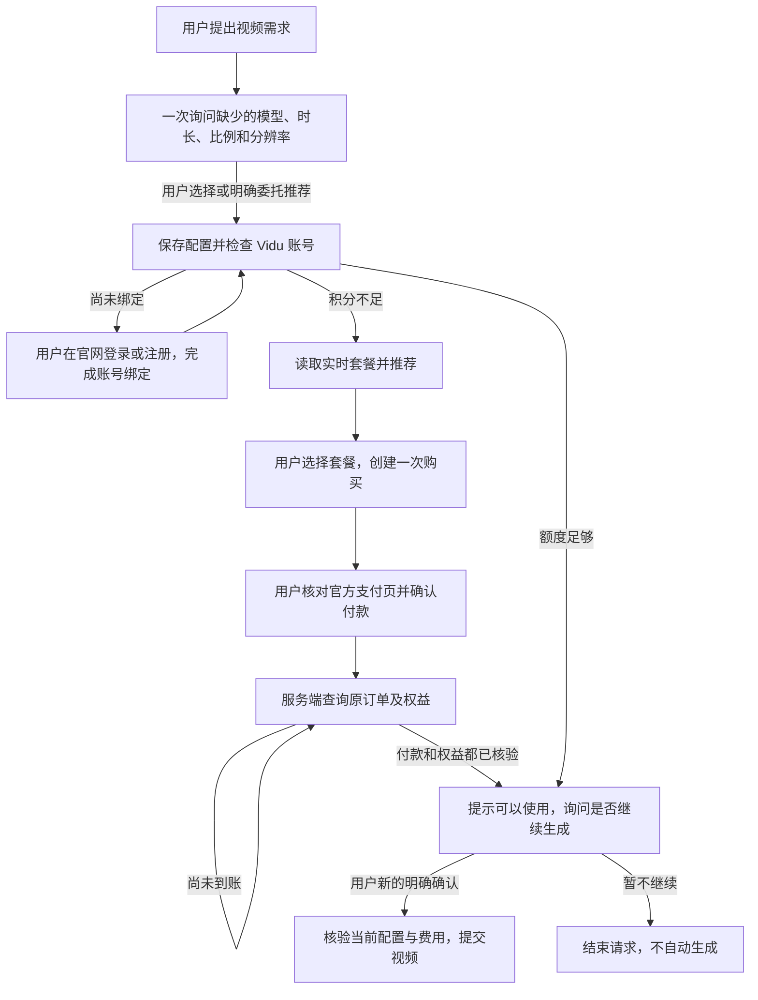

# 映伴 · 自建智能体 HTTP/MCP 接入（0.8.0）

0.8.0 新增对话内可交互官网面板：注册、登录和原订单官方支付页面在宿主界面内显示。HTTP 新增 `POST /v1/browser-panels`，MCP 新增 `vidu_open_official_panel` 及 MCP Apps 资源，共 22 个 HTTP 操作、20 个 MCP 工具。多用户可通过独立浏览器映射和 `--account-vault-root` 完成界面授权；具体配置与私密 `_meta` 转发要求见[官方面板接入](official-panel.md)。下文保留原始连接接口用于兼容不支持界面的宿主。

当前项目提供一个独立 Python 服务。你的智能体可以通过 HTTP 或远程 MCP 调用同一套用户、订单和视频工作流；不需要先开发对话界面。

0.5.0 新增持久化参数对话：遗漏字段先询问，明确委托才推荐，回答完成后直接关联原视频工作流。HTTP 与 MCP 共用状态；模型、时长、比例、分辨率在直接配置接口中改为必填，避免静默绕过提问。已有网页控制台保留为辅助入口。详细约定见[对话接入](agent-conversation.md)。

0.6.0 增加[官网浏览器购买](browser-commerce.md)：无需合作购买 API，通过每用户专用浏览器读取真实月付套餐并准备标准版、专业版官方支付页。增加浏览器会话和官网订单观察的 HTTP/MCP 接口、独立套餐选择及本机浏览器启动器。

0.6.1 修复登录页重复打开：连接检查不导航或创建标签页，登录期间跳过套餐检查，保留用户当前的登录和付款窗口。

0.7.0 增加本机国际站官网快捷连接。用户在专用浏览器登录后，在连接窗口点击授权；服务读取该账号可见的 Vidu Token 面板，通过真实接口验证后保存到系统凭据库，并保存同一官网账号的关联证据。已有手动授权只有与官网授权一致时才关联，不覆盖不同账号。连接和状态查询不会生成视频。

**支付成功与权益到账的自动核验仍未完成，浏览器模式不返回已核验的 ready。** 视频适配器使用 Vidu 官方开源 CLI 所采用的真实接口。未配置计费方式时返回 `501 billing_not_configured`，不使用模拟结果。没有自动注册接口，不能把智能体登录直接视为 Vidu 授权；以 `account_link_verified` 判断官网与视频授权是否已关联。

## 流程和当前范围



- 已实现：用户 JWT 验证、权限和数据隔离、报价有效期、购买请求防重复、可信订单查询、SSE 支付状态通知、配置保存、单独生成确认、任务查询。
- 真实 Vidu 能力：读取官网账号积分、查询视频预计积分、文生视频提交和任务查询。已通过 HTTP/MCP 使用 6 赠送积分生成一条真实视频，余额由 20 变为 14，详见发布记录。
- 购买方式二选一：`--browser-bindings` 使用真实官网浏览器；`--billing-config` 使用运营者提供的真实计费网关。[网关协议](commerce-gateway.md)是我们定义的接入协议，不是 Vidu 官方购买 API。浏览器方式的到账核验尚未完成。
- 当前计费模型只处理国际站 USD 月付套餐，显式保留首期价、续费价、自动续费和积分；年付、单次充值、其他币种尚未实现。不要将 API 平台积分冒充官网会员额度。
- 支付确认由用户完成。当前接口返回可信结账链接；是否可在自建应用里嵌入支付页面，需要支付供应方支持。服务不接收卡号、密码、验证码，也没有“确认扣款”的 MCP 工具。
- 账号绑定：本机国际站可在用户确认后从官网可见 Token 面板连接；也保留手动填写入口。不读取 Cookie、浏览器存储、网络拦截或剪贴板，不重置 Token。公网模式仍由部署方配置用户与授权的对应关系。尚未提供公网自助 OAuth 绑定、自动注册或订阅取消入口。

## 对话内发起账号连接

`POST /v1/account/connection` 或 MCP `vidu_connect_account` 返回 `connection_action`。宿主把它渲染为“连接 Vidu”按钮；链接为五分钟内可用的一次性本机控制页入口。链接不包含 Vidu Token。用户在该页点击“打开官网登录 / 注册”，使用已配置的专用浏览器，再点击“我已登录，授权并连接”。中国站或未配置专用浏览器时使用手动授权。

`GET /v1/account/connection` 或 MCP `vidu_connection_status` 只查询账号与关联状态。`account_link_verified=true` 表示有效视频授权与当前官网账号关联；此时通知用户可以继续配置视频，不自动提交。HTTP 的两个操作及对应 MCP 工具要求 `vidu:video` 和 `vidu:purchase` 权限。JS 客户端对应 `connectAccount()`、`accountConnection()`。

兼容的本机窗口通过 HttpOnly 会话和 CSRF 保护的 `/console/account/browser` 导入授权。0.8.0 面板通过独立短期会话的 `/panel/authorize` 接受用户明确授权，不接收 Token 工具参数。已有授权不同、验证失败或连接期间切换账号时保留原授权。断开会删除凭据和关联证据，使旧工作流失效。仍需预先配置并启动每个用户的专用浏览器；没有官方 OAuth 或浏览器集群自动分配。

## 本机启动

Python 3.12 与 `uv`；JavaScript 客户端适用于 Node.js 22+ 或支持 Fetch、ReadableStream、AbortSignal.any 的现代浏览器。

```powershell
uv sync --locked
# 使用官网浏览器购买时，先运行并在专用窗口登录：
uv run python -X utf8 scripts/browser_session.py
uv run python -X utf8 scripts/selfhost_local.py serve
```

点击启动窗口输出的“打开控制页”链接，浏览器会建立本机会话并立即移除地址中的一次性票据。票据五分钟内有效且只可使用一次；浏览器会话最多八小时，服务重启后重新打开启动链接。重新获取入口可运行 `uv run python -X utf8 scripts/selfhost_local.py link`。

本机控制页默认开放生成能力，但只有点击当前费用确认按钮后才会提交任务。保存需求、刷新状态、连接账号和支付成功都不会自动生成。如只想检查接口，使用 `serve --read-only`。直接运行 `vidu-selfhost` 的部署入口仍需 `--enable-live-generation` 才开放提交。

另一个终端只读检查：

```powershell
uv run python -X utf8 scripts/selfhost_local.py check
```

辅助脚本只监听 `127.0.0.1:8787`，自动生成本机服务访问令牌，保存到原生系统凭据库；不会打印它或将其写进项目。这不是 Vidu Token。检查结果写入 `.local/selfhost-verification.json`，不会付款或提交视频。

| 地址 | 用途 |
| --- | --- |
| `http://127.0.0.1:8787/healthz` | 无鉴权的进程健康检查，不代表计费已就绪 |
| `http://127.0.0.1:8787/v1` | HTTP 接口前缀，所有接口均需 Bearer Token |
| `http://127.0.0.1:8787/v1/openapi.json` | 与运行代码一致的 OpenAPI 3.1 文档，需鉴权 |
| `http://127.0.0.1:8787/mcp` | Streamable HTTP MCP，需同一个用户的 Bearer Token |

如果需要自行控制本机服务令牌，可先在终端环境中设置至少 32 位的 `VIDU_SELFHOST_TOKEN`，然后 `uv run vidu-selfhost`。不要在聊天或 URL 中传令牌。仅本机监听允许静态令牌，对应身份固定为 `local-user`。

## 配置真实视频账号

参考 `examples/accounts.example.json` 创建 `.local/accounts.json`：键是经过验证的用户 `sub`；本机辅助模式为 `local-user`。值包含 `token_env` 和 `region`，实际 Vidu Token 由服务器环境变量或部署秘密管理系统注入。国际站为 `global`，中国站为 `cn`。不同用户不能配置同一个 Token 环境变量名，也不应使用同一个 Vidu 账号。

Token 由用户从 Vidu 官方账号菜单取得；本服务不提取浏览器 Cookie，也不接受智能体工具参数中的 Token。未绑定返回 `not_connected`，过期返回 `login_required`，未知余额保持 `null`。

独立部署入口默认禁止扣积分生成。准备真实生成验收时，通过 `--enable-live-generation` 开启部署能力；本机控制台辅助入口则默认允许用户手动确认生成。两种方式每次都需要确认最新配置和积分消耗，付款成功不会绕过这一步。

不要在同一 `sub` 下直接切换到另一个 Vidu 账号而保留待确认任务。当前版本没有自动识别账号换绑的能力；换到另一个 Vidu 账号时使用新的绑定身份并结束旧工作流。Token 续期必须属于同一个账号。

## 多用户部署与授权

公网由你的智能体登录系统签发用户访问令牌。服务验证签名、`iss`、`aud`、`exp`、`nbf` 和非空 `sub`；不以共享的 `client_id` 识别用户。当前是资源服务，不负责签发 Token 或提供完整 OAuth 授权服务器。

配置环境变量：

| 变量 | 内容 |
| --- | --- |
| `VIDU_JWKS_URI` | 你的身份提供方公开 JWKS HTTPS 地址 |
| `VIDU_TOKEN_ISSUER` | 令牌 `iss`，HTTPS，必须精确匹配 |
| `VIDU_TOKEN_AUDIENCE` | 专属于这个 API 的 `aud` |
| `VIDU_ACCOUNT_<NAME>_TOKEN` | 用户明确授权的 Vidu 官网 Token，仅服务器保存 |
| `VIDU_COMMERCE_<NAME>_TOKEN` | 你取得的真实计费网关凭据，仅服务器保存 |

权限 `vidu:video` 用于账号、配置和视频操作，`vidu:purchase` 用于套餐和订单；与视频关联的套餐推荐、购买需要同时具备两者。

```powershell
uv run vidu-selfhost --host 0.0.0.0 --port 8787 --public-url https://your-service.example --accounts .local/accounts.json
```

上述域名需要替换；项目没有部署该域名。TLS 由反向代理终止，内部端口仅向代理开放。服务不信任转发 IP 头。默认不开放 CORS；浏览器直连时使用 `--cors-origin https://your-agent.example` 指定精确来源。MCP 客户端需支持携带你的用户 Bearer Token，当前不宣称任意宿主均能自动完成 OAuth 发现与安装。

使用官网浏览器时，加上 `--browser-bindings .local/browser-bindings.json`，详见[浏览器购买接入](browser-commerce.md)。两种计费参数不能同时使用。若取得真实网关接入，可改用 `--billing-config .local/billing-gateway.json`；参考 `examples/billing-gateway.example.json`，其中 `example.invalid` 是不可用的占位域名。计费用户与视频账号应对应同一 Vidu 账号，需要上游与运营配置保证。

SQLite 记录保存在 `.local/selfhost.sqlite3`，包含提示词、配置、报价及订单引用，不包含 Vidu Token。生产部署需使用持久化磁盘、备份和访问控制，不能把数据库放到多副本共享网络文件系统。反向代理负责请求频率限制；日志不得记录 Authorization、支付链接和完整请求体。本版本尚未提供多区域部署、退款核验和订阅生命周期管理。

## HTTP 与 MCP 对照

除了 `/healthz`，HTTP 均需 `Authorization: Bearer <用户访问令牌>`。请求 JSON 不允许额外字段，不允许客户端指定 `owner` 或报告 `paid`。金额为整数分，时间戳为 Unix 秒。

| HTTP | MCP 工具 | 行为 |
| --- | --- | --- |
| `GET /v1/capabilities` | `vidu_purchase_capabilities` | 检查真实可用能力 |
| `GET /v1/account` | `vidu_account_status` | 检查 Vidu 绑定和积分 |
| `POST /v1/video-briefs` | `vidu_prepare_video_request` | 记录明确参数、询问缺失项；需 `Idempotency-Key` |
| `PATCH /v1/video-briefs/{id}` | `vidu_answer_video_questions` | 补充回答或委托推荐，需最新 `revision` |
| `GET /v1/video-briefs/{id}` | `vidu_get_video_brief` | 恢复对话；齐全后关联同一视频工作流 |
| `GET /v1/plans` | `vidu_list_plans` | 从计费上游读取套餐，签发 180 秒报价 |
| `GET /v1/commerce/session` | `vidu_commerce_session` | 读取专用官网浏览器的连接和登录状态 |
| `GET /v1/commerce/orders` | `vidu_website_orders` | 读取官网可见订单表，不等于已验证付款 |
| `POST /v1/purchases` | `vidu_prepare_purchase` | 使用 `quote_id` 创建一次购买，需 `Idempotency-Key` |
| `GET /v1/purchases/{id}` | `vidu_check_purchase` | 通过服务器查询订单及权益 |
| `GET /v1/purchases/{id}/events` | 使用同一查询工具轮询 | SSE 通知，仅针对已创建购买 |
| `POST /v1/videos` | `vidu_start_video_request` | 已明确四项参数的完整配置入口；不提交视频 |
| `GET /v1/videos/{id}` | `vidu_get_workflow` | 更新工作流状态，不提交视频 |
| `PATCH /v1/videos/{id}` | `vidu_update_video_request` | `config` + 最新 `revision`，旧生成确认失效 |
| `POST /v1/videos/{id}/recommend` | `vidu_recommend_plans` | 额度不足时推荐套餐 |
| `POST /v1/videos/{id}/purchase` | `vidu_purchase_for_video` | `quote_id` + `revision`，保存原视频需求 |
| `POST /v1/videos/{id}/confirm` | `vidu_confirm_generation` | 用户新确认后使用 `confirmation_id` 提交一次视频 |
| `POST /v1/videos/{id}/cancel` | `vidu_cancel_video_request` | `revision`，放弃尚未提交的生成；不会取消订阅 |
| `GET /v1/openapi.json` | 无 | 完整输入 Schema |

视频请求示例（参数示例，不是视频结果或套餐数据）：

```json
{
  "config": {
    "prompt": "白色背景下，产品缓慢旋转，柔和光线",
    "model_version": "3.2",
    "duration": 8,
    "resolution": "1080p",
    "aspect_ratio": "16:9",
    "sample_count": 1,
    "schedule_mode": "auto"
  }
}
```

参数有效组合以 [OpenAPI](openapi.json) 和服务验证为准。当前只提供文生视频；不要用未实现的图片、参考视频或充值参数调用。

## 对话界面的接法

复用 `sdk/yingban-client.mjs`，把已登录用户的访问令牌交给 `getAccessToken`；Vidu Token 不经过客户端。各动作分别由对应用户操作触发，下面不是一段付款后自动执行生成的脚本。

```javascript
import { YingbanClient } from "./sdk/yingban-client.mjs";

const vidu = new YingbanClient({
  baseUrl: "https://your-service.example",
  getAccessToken: () => session.getAccessToken(), // 替换为你的登录系统
});

// 用户发来视频需求时：仅传明确内容，固定 requestKey，重试保持不变。
const brief = await vidu.prepareVideoRequest({ prompt: userVideoDescription }, requestKey);
// 展示 brief.question；以下调用只在用户回复“其余帮我选”之后进行。
const answered = await vidu.answerVideoQuestions(brief.brief_id, {
  revision: brief.revision,
  use_recommended_for: ["model_version", "duration", "aspect_ratio", "resolution"],
});
const flow = answered.workflow; // 沿用这个工作流，不再调用 startVideo。
// needs_purchase 时读取套餐；由界面展示首期/续费价格、积分、自动续费。
const offers = await vidu.recommendPlans(flow.workflow_id);
// 用户选择后：使用实际选择的报价，不要固定使用推荐结果。
const payment = await vidu.purchaseForVideo(flow.workflow_id, selectedQuoteId, offers.revision);
```

展示 `payment.purchase.plan` 作为对话内的核对卡片。浏览器模式下调用 `vidu.openOfficialPanel("payment", payment.purchase_id)`，在宿主内显示返回的面板，用户操作其中的真实官方支付页。`payment_action.embedded:false` 继续表示该上游结账 URL 不是原生嵌入式支付组件；不要直接 iframe 上游 URL。面板使用独立浏览器传输画面，详见[官方面板接入](official-panel.md)。

```javascript
for await (const event of vidu.purchaseEvents(payment.purchase_id, { signal })) {
  if (event.event === "purchase") updatePurchaseCard(event.data);
  // ready 仅代表订单和权益已核验。这里不调用 confirmGeneration。
}
// 支付已 ready 后读取原工作流，取得最新费用与 continuation_prompt。
const current = await vidu.getWorkflow(flow.workflow_id);
// 将当前配置、费用和 continuation_prompt 展示给用户；等待用户新的明确回复。
```

**仅用户新确认事件的处理器**可以调用：

```javascript
await vidu.confirmGeneration(current.workflow_id, current.confirmation_id);
```

返回 `awaiting_generation_confirmation` 且确认编号变化时，应重新展示费用、等待用户选择，不能自动提交新编号。提交结果为 `submission_unknown` 时，到官网核对原任务，不换请求编号重试。

SSE 通过带 Bearer 头的 Fetch 读取，不能直接用无法设置该头的原生 EventSource。单条连接等待约 55 秒，加上上游请求时间后结束；若仍待付款，用同一 `purchase_id` 重新连接。`auth_expired` 表示先刷新登录令牌，`verification_unavailable` 表示保留原订单稍后再查。它是最新状态通知，不保证历史事件重放。SDK 不会自动重连或重试写操作。

## 错误处理

| HTTP / code | 客户端处理 |
| --- | --- |
| `401` | 重新登录或刷新访问令牌 |
| `403 insufficient_scope` | 当前登录授权未包含该动作 |
| `404 *_not_found` | 不存在或不属于当前用户，不切换身份猜测 |
| `409 quote_expired` / `workflow_changed` | 读取新报价或版本，必要时重新确认 |
| `409 brief_changed` | 读取原参数对话的最新 `revision` 再回答 |
| `409 brief_finalized` | 参数已关联视频工作流，后续修改用视频配置接口 |
| `409 idempotency_conflict` | 同一请求编号用于不同内容，纠正客户端调用 |
| `422 invalid_input` | 修正配置或请求结构 |
| `501 billing_not_configured` | 明确告知购买尚未接入，不展示假套餐 |
| `502` / `verification_required` | 保留原购买，查询同一 ID，不重复下单 |
| `503` / 网络超时 | 结果不明；复用同一请求编号或查询原记录 |

订单 `ready` 必须同时有可信的付款成功和权益生效证据，回跳参数、用户口述和余额增加都不能替代。已支付记录不会因旧响应被降级；同一官方订单号不能完成两笔购买。

## 验证与交付

```powershell
uv run pytest -q
uv run ruff check src tests scripts
node --test sdk/yingban-client.test.mjs
uv run python -X utf8 scripts/build_selfhost.py
```

构建结果为 `dist/yingban-selfhost-0.8.0.zip` 和 SHA-256 文件，附带图标、SDK、MCP Apps 资源及源代码、OpenAPI、锁定依赖、浏览器适配器和接入说明。按允许清单排除演示 Provider、测试夹具、账号凭据和历史数据库。原 Codex 本机插件仍是独立的 0.3.0 包。

测试中的 HTTP 响应夹具仅用于验证协议和状态控制；实际服务启动不装配它们。上线验收仍需要真实 Vidu 账号、可授权的官网计费接入、用户确认的一笔真实付款和一次真实视频任务。当前没有执行这两类付费操作。

接口依据：[Vidu 官方开源 CLI](https://github.com/shengshu-ai/vidu-cli)、[官方账号接入说明](https://github.com/shengshu-ai/vidu-skills/blob/main/references/setup.md)、[FastMCP HTTP 部署](https://gofastmcp.com/deployment/http)。官网套餐和 API 平台的积分是不同产品，见 [Vidu API 平台说明](https://platform.vidu.com/docs/quick-start)。
